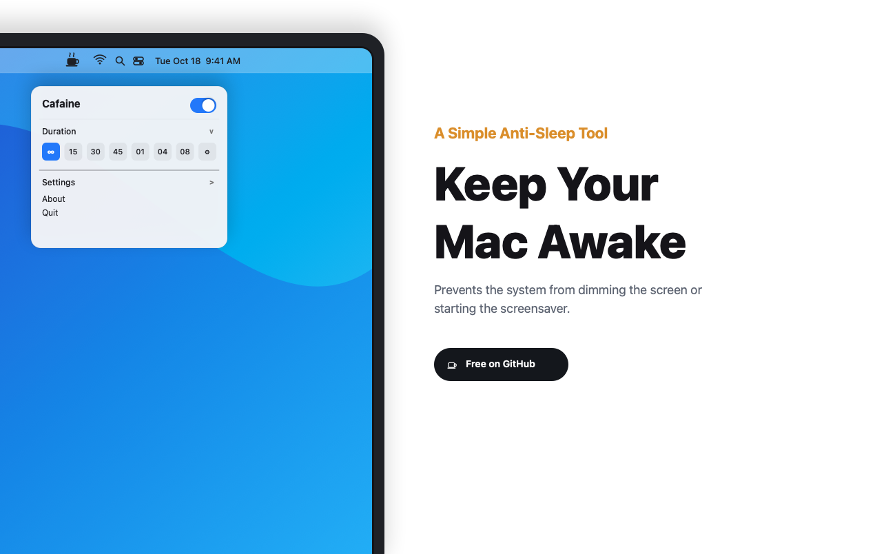
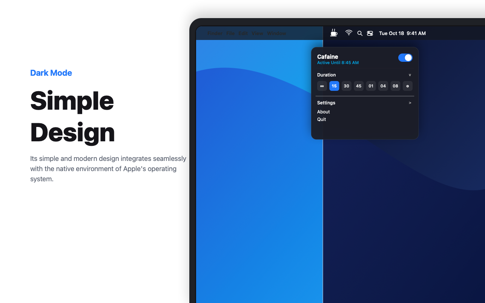
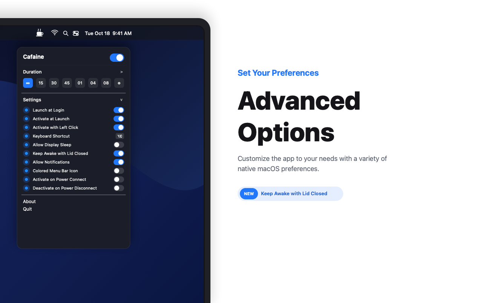
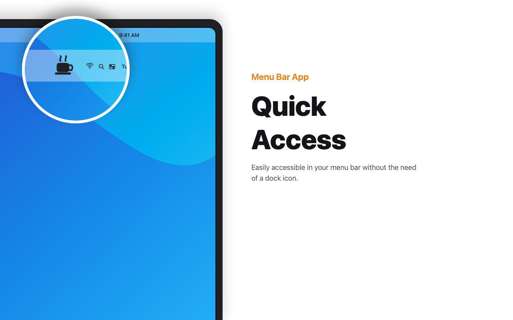
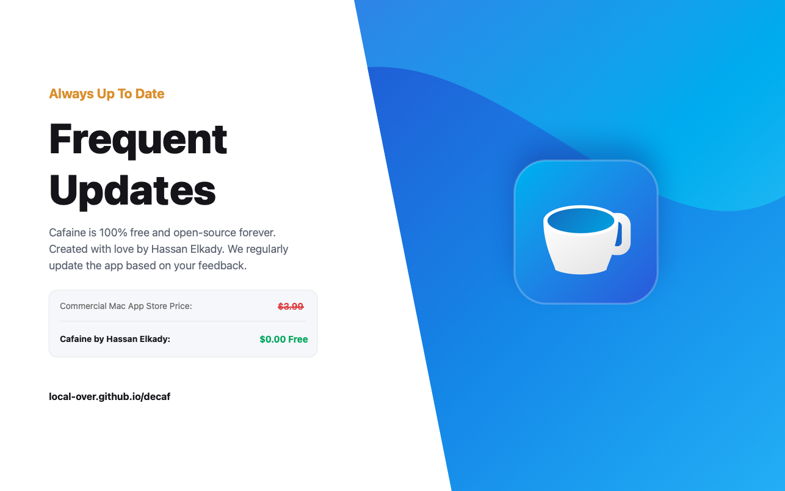

# Cafaine: Anti-Sleep Tool for macOS

<p align="center">
  <a href="https://local-over.github.io/decaf">
    
  </a>
</p>

<p align="center">
  <a href="https://github.com/local-over/decaf/releases/latest"></a>
  
  
  
  <a href="LICENSE"></a>
</p>

Cafaine is a 100% free and open-source anti-sleep utility for macOS. It prevents your Mac from sleeping, dimming the display, or starting the screensaver, operating directly from your menu bar with zero background overhead.

Created by **Hassan Elkady** ([@local-over](https://github.com/local-over)).

Website and Interactive Showcase: **[local-over.github.io/decaf](https://local-over.github.io/decaf)**

---

## Slide Gallery

<details open>
<summary><b>Click to expand high-resolution App Store slides</b></summary>
<br>

| 1. Keep Your Mac Awake | 2. Simple Design (Dark Mode) |
| :---: | :---: |
| <a href="assets/screenshot-1.png"></a> | <a href="assets/screenshot-2.png"></a> |
| **3. Advanced Options** | **4. Quick Access** |
| <a href="assets/screenshot-3.png"></a> | <a href="assets/screenshot-4.png"></a> |
| **5. 100% Free Forever** | |
| <a href="assets/screenshot-5.png"></a> | |

</details>

---

## Features

- **Single-Click Activation:** Click the coffee cup in your menu bar to toggle active and inactive states.
- **Custom Durations & Presets:** Quick activation presets for `[ ∞ ]`, `[ 15 ]`, `[ 30 ]`, `[ 45 ]`, `[ 01 ]`, `[ 04 ]`, `[ 08 ]`, or custom duration (`[ ⚙ ]`).
- **Animated Menu Bar Indicator:** Dynamic rising steam vector animation in the macOS menu bar when active.
- **Display Sleep vs. System Sleep:** Configure whether the display stays illuminated or only background tasks and downloads stay active.
- **Power Management Automation:** Auto-activate when connecting to power, or auto-deactivate when disconnecting from charger.
- **Closed-Lid Operation:** Keep your system running when the MacBook lid is closed.
- **Launch at Login:** Native integration with macOS Service Management.
- **Global Keyboard Shortcut:** Toggle sleep prevention with `⌥C` (Option + C).
- **Zero Dependencies:** Built in pure Swift using native Apple IOKit power management APIs. Uses ~15MB RAM and 0% CPU.

---

## Comparison: Cafaine vs. Mac App Store Commercial Apps

| Feature | Cafaine (Open Source) | Commercial App Store Apps |
| :--- | :---: | :---: |
| Price | **$0.00 (Free Forever)** | $3.99 / Paid |
| License | MIT License | Proprietary / Closed Source |
| Native IOKit APIs | Yes | Yes |
| Custom Durations | Yes | Yes |
| Closed-Lid Support | Yes | Yes |
| Power Source Automation | Yes | Yes |
| Telemetry & Tracking | Zero (Offline) | Proprietary analytics |
| Dock Icon | None (Strictly Menu Bar) | None |

---

## Installation

### Pre-built Release
1. Download `Cafaine-macos.zip` from the [Releases](https://github.com/local-over/decaf/releases) page.
2. Unzip and move `Cafaine.app` into `/Applications`.
3. Launch `Cafaine` from Spotlight or Finder.

### Build from Source
Requirements: macOS 13.0 or later with Xcode Command Line Tools.

```bash
git clone https://github.com/local-over/decaf.git
cd decaf
make bundle
make run
```

---

## Developer Support & Donations

If Cafaine is helpful to your daily workflow, consider supporting **Hassan Elkady**:

- **PayPal:** [paypal.me/HassanElkady2](https://paypal.me/HassanElkady2)
- **USDT (TON Network / TRC20):** `UQBEJwLa4EGPRmUKw4O1i9d_JjJGmjkJ2myqR5lborzgceT-`
- **Donation Web Page:** [local-over.github.io/decaf/donate.html](https://local-over.github.io/decaf/donate.html)
- **GitHub:** [@local-over](https://github.com/local-over)

---

## License

Cafaine is licensed under the [MIT License](LICENSE).
